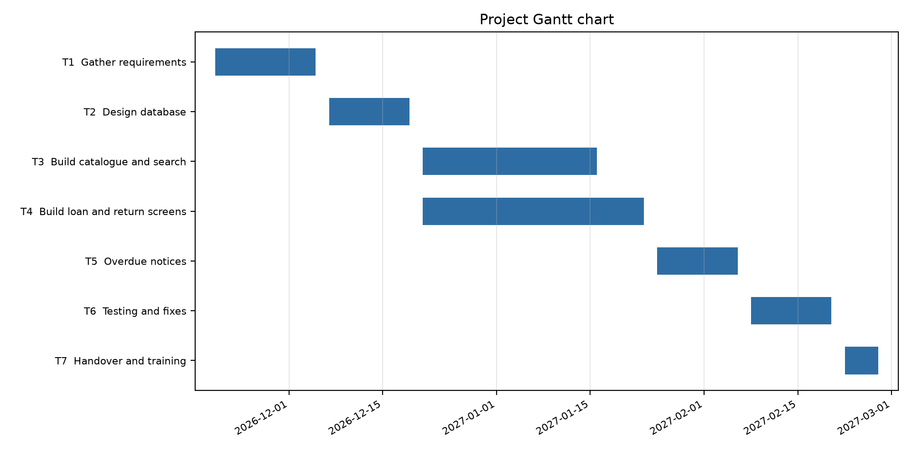
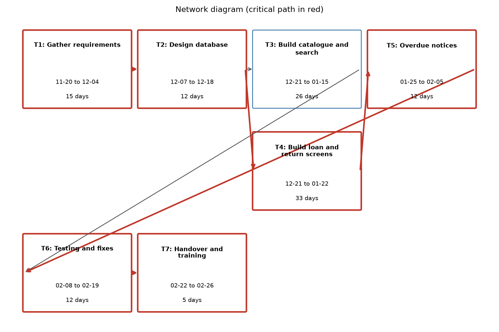

# Overview

The schedule covers the work from approval to handover. Dates are written as YYYY-MM-DD so the chart script can read them.

# Milestone List

| Milestone | Due Date | Owner | Status |
|---|---|---|---|
| Requirements approved | 2026-12-04 | Ana | Planned |
| Database and search working | 2027-01-15 | Ben | Planned |
| Handover to the library | 2027-02-26 | Ana | Planned |

# Task Schedule

| ID | Task | Start | End | Duration | Owner | Depends On |
|---|---|---|---|---|---|---|
| T1 | Gather requirements | 2026-11-20 | 2026-12-04 | 15 | Ana | |
| T2 | Design database | 2026-12-07 | 2026-12-18 | 12 | Ben | T1 |
| T3 | Build catalogue and search | 2026-12-21 | 2027-01-15 | 26 | Ben | T2 |
| T4 | Build loan and return screens | 2026-12-21 | 2027-01-22 | 33 | Cara | T2 |
| T5 | Overdue notices | 2027-01-25 | 2027-02-05 | 12 | Cara | T4 |
| T6 | Testing and fixes | 2027-02-08 | 2027-02-19 | 12 | Ben | T3, T5 |
| T7 | Handover and training | 2027-02-22 | 2027-02-26 | 5 | Ana | T6 |

# Gantt Chart

# Network Diagram and Critical Path

The critical path is T1, T2, T4, T5, T6, T7, which totals 89 days.

# Schedule Assumptions

- Each team member works on the project ten hours per week.
- The library sponsor answers questions within two working days.

# How the Schedule Is Tracked and Changed

The team reviews the schedule every Friday. A change of more than three days needs approval from the sponsor and a change request.

# Revision History

| Version | Date | Description | Author |
|---|---|---|---|
| 1.0 | 2026-11-16 | First draft | Team Example |